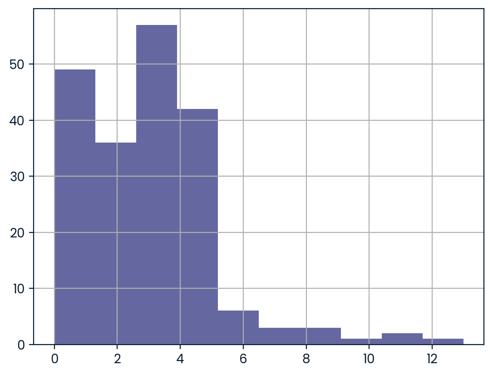
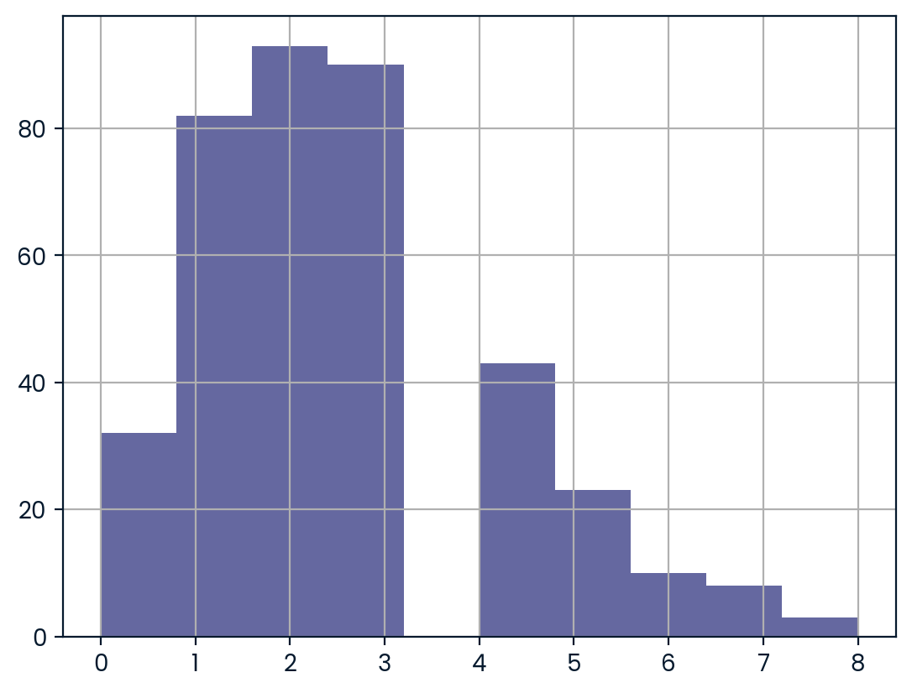

# Do Women's World Cup Matches Have More Goals Than Men's?


## Overview

This project is a case study in which I took on the role of a sports journalist at a major online sports media company, specializing in soccer analysis. The scenario: a hunch that more goals are scored in women's international matches than in men's, and a need to back it up with a valid statistical hypothesis test before writing an article about it.

Because the sport has changed a lot over the years and scoring varies by tournament, the analysis is limited to **official FIFA World Cup matches (qualifiers excluded) played since 2002-01-01**, for both men and women.

## Research Question

> Are more goals scored in women's international soccer matches than men's?

## Hypotheses

Significance level: **α = 0.10**

- **H₀:** The mean number of goals scored in women's international soccer matches is the same as men's.
- **Hₐ:** The mean number of goals scored in women's international soccer matches is greater than men's.

## Dataset

Two CSV files containing the results of international football matches, scraped from a reliable online source:

- `women_results.csv`
- `men_results.csv`

Columns used in this analysis:

| Column | Description |
|--------|-------------|
| `date` | Date of the match |
| `tournament` | Tournament name (filtered to `FIFA World Cup`) |
| `home_score` | Goals scored by the home team |
| `away_score` | Goals scored by the away team |

A new column, `goals_scored`, was created as `home_score + away_score` to get the total goals in each match.

## Approach

1. **Load and filter** both datasets to FIFA World Cup matches after 2002-01-01.
2. **Compute total goals per match** for each group.
3. **Visualize** the distribution of goals per match for women and men with histograms.
4. **Choose the test:** goals per match are discrete counts with a skewed distribution, so the non-parametric **Mann-Whitney U test** (one-sided, `alternative="greater"`) was used instead of a t-test.
5. **Compare the p-value to α = 0.10** to decide whether to reject H₀.

## Results

### Distribution of Goals per Match

| Women | Men |
|:-----:|:---:|
|  |  |

| Metric | Value |
|--------|-------|
| Test | Mann-Whitney U (one-sided) |
| Significance level (α) | 0.10 |
| p-value | 0.0051 |
| Decision | **Reject H₀** |

Since the p-value (about 0.005) is well below 0.10, we **reject the null hypothesis**. There is statistically significant evidence that more goals are scored per match in women's FIFA World Cup matches than in men's, for matches since 2002.

### Key Takeaways

- In the scenario, the journalist's hunch is supported by the data, so the article would be worth writing.
- The result applies only to **FIFA World Cup matches since 2002**. It should not be generalized to all international matches, other tournaments, or earlier eras.
- A significant p-value shows the difference is unlikely to be due to chance, but not how large it is. Reporting the average goals per match for each group would add useful context.

## Tools and Libraries

- Python
- pandas
- matplotlib
- SciPy (`scipy.stats.mannwhitneyu`)
- Jupyter Notebook

## Repository Structure

```
├── README.md
├── notebook.ipynb        # Analysis code
├── women_results.csv
├── men_results.csv
├── soccer-pitch.jpg      # README header image
├── women.png             # Women's goals-per-match histogram
└── men.png               # Men's goals-per-match histogram
```

## Possible Next Steps

- Report mean and median goals per match, plus sample sizes, for both groups.
- Add an effect size or confidence interval for the difference.
- Break the comparison down by individual tournament year to see if the gap is consistent.
- Check whether the gap is driven by a few lopsided women's matches.
